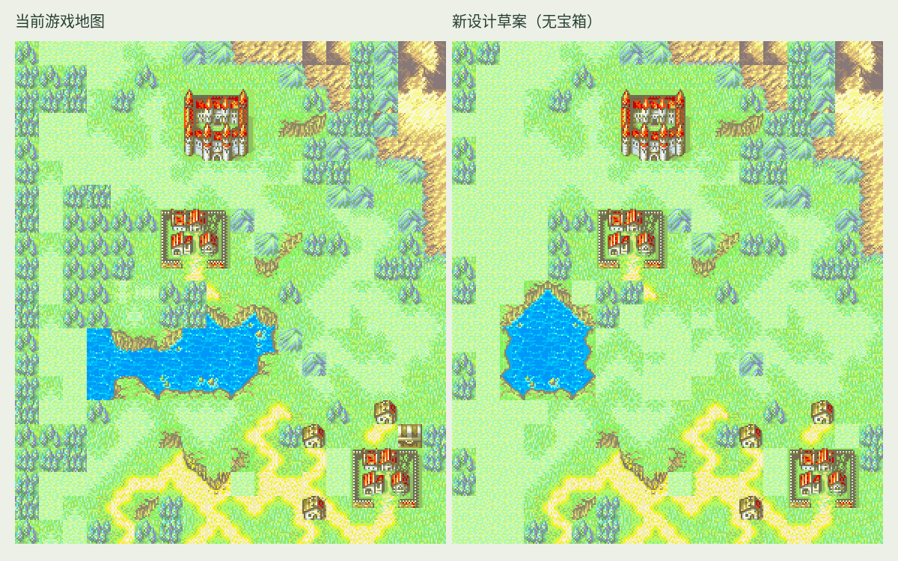

# 第一章：实际地块方案 B（待评审）

[查看无标记的三倍预览](ch1-map-proposal.png) · [metatile 表](ch1-map-proposal.csv)

> 此图使用 `MapAsset01/ConfImg.png` 中的实际 16×16 metatile 拼接，非游戏截图；每格对应 CSV 中一个十进制 metatile 编号。此为评审稿，不改变游戏运行内容。与上版概念图不同，本稿按实际 LUT 检查村庄、山、水及通行。图片尚未经过目视审查，不能保证美术拼接没有瑕疵。

## 设计

- **湖与西岸**：将原来接地图左边界的不完整水域重塑为独立的小湖，保留不规则岸角；西侧留连续的草地通路，消除原先一整列重复森林的格栅感。受现有 tileset 限制，湖面地形实际为 `SEA`，岸边为 `CLIFF`，都不能作为一般陆军的落脚点；通路位于岸外而非岸上。
- **中部**：旧湖东侧部分改为开阔草地，保留两侧推进空间；西侧路与城堡南侧相通。部分地块会使用原版草地变化，**并非已经完成连续路面美术**，路线以可通行地面为主，后续仍需根据画面修整。
- **城堡、村庄和聚落**：城堡及两村的 3×3 组件与坐标不变，地图变更区域不动；保留三间现有房屋。村庄非门组件并不可通行，不再将路线画穿村庄外墙。
- **宝箱**：按要求从方案中移除 `(16,16)` 的宝箱地块，用草地替代，不放置补偿宝箱或奖励。**当前 ROM 宝箱及事件尚未删除**：设计稿获得批准后，实现时必须同时修改地图和移除 `(16,16)` 的 `EvtListChest`，不能仅改画面。
- 与现行地图比较共 88 格不同；尺寸仍为 18×21。本案是对既有版本的重构，不声称逐格复原原版。

## 静态核对结果

读取 `TsaConf.c` 的 LUT，并与仓库原始 `MapAsset01_TsaConf.tsa` 的 LUT 校验一致；检查城堡、两村完整组件、三处房屋及关键事件地形。用实际职业移动表，按每回合剩余移动力逐格搜索，忽略单位占格、战斗、增援和事件：

| 单位 / 移动力 | 到北村 (7,9) | 到南村 (15,19) | 到城门 (8,4) |
|---|---:|---:|---:|
| Roy / 6 | 第 2 回合 | 第 3 回合 | 第 4 回合 |
| Wolt / 5 | 第 2 回合 | 第 3 回合 | 第 4 回合 |
| Bors / 4 | 第 4 回合 | 第 3 回合 | 第 7 回合 |
| Alen / 7 | 第 2 回合 | 第 2 回合 | 第 4 回合 |
| Marcus / 8 | 第 2 回合 | 第 2 回合 | 第 3 回合 |

从各单位现行战斗站位开始；城门对于非 Roy 只用作可达性验证，非制压资格。这里的“第 N 回合”是静态最短移动估计，不是实战结果。湖岸区域相邻边做了水色掩码差异检查，无大于 3 像素的差异；该启发式不是无缝证明，仍需目视检查。

## 实现前必须解决的问题

1. **T5 增援载入点**：现有事件中两名敌人分别从 `(6,8)`、`(7,8)` 加载，这两格位于北村组件，地形均为不可通行的 `TERRAIN_TILE_2E`。这是现行事件已有的问题，不可直接宣称可走。实现时需调整载入点并验证正常播放和跳过事件。
2. **原有事件的出场与位移**：其他载入/移动终点静态检查均为对应职业可通行地形，但沿途寻路、同时占格、Boss 移动和 AI 未验证。
3. **村庄的破坏和关闭**：保留 map change 坐标不代表运行正确，须验证两个村庄访问与劫掠的前后效果。
4. **美术审阅**：检查湖的闭合转角、草地/崖岸接缝、靠地图边界的林缘、建筑周围；如有硬边需调整。当前执行环境不能直接目视图像。
5. **完整验证**：修改并渲染实际地图后运行 `make all`、`./tools/emu/testmenu-tests.sh`，检查游戏截图以及开场、跳过、T2/T3/T5、村庄和制压。当前仅进行了方案数据静态检查，未构建、未运行模拟器。

## 需要评审

1. 湖的规模和位置是否符合预期？是否需要更大的水面？
2. 西路是否保留现在的开阔度，还是希望局部更窄并安排敌人防守？
3. 中部平原和右侧山脊是否要进一步重做，而非以现行地图为基础修整？

生成与静态检查脚本：`ch1-map-proposal.py`。为了保护评审文件，脚本默认不会覆盖现有 CSV 和图片。
