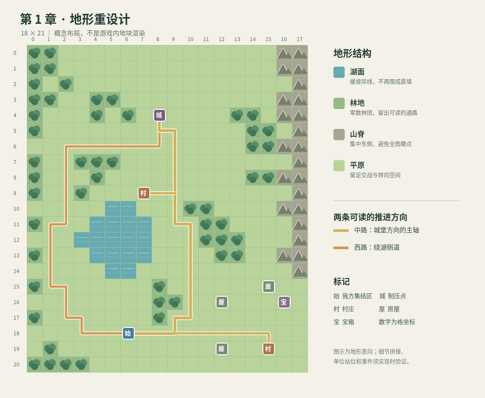

# 第 1 章地图重新设计：方案 A（历史概念稿）

> 已被 [实际地块方案 B](ch1-map-proposal.md) 取代。下文中的宝箱和路线仅作历史记录；新方案已按要求移除宝箱。此稿将村庄组件视为可通行，连通性结论不能用于游戏内验证。



> 这是 18 × 21 的**概念地形图**，不是 `MapAsset01` 的实际拼接结果，也不是游戏内截图。原设计和现有代码均未改动；评审通过前不改 `.c`、事件或地图变更。

## 设计结论

- **湖西取消笔直的森林、草地条带**。湖收缩为西中部较紧凑的不规则水面，西岸以缓坡和可站立地面接水，林地分成疏密不同的小林团；不以整排树木遮掩旧地图边界的断面。西侧路径在湖湾处稍向西偏，不沿湖岸切成一条长直线。
- **整体按地理与用途分区**：北部城堡，西中部湖与村庄，中部交战平原及主路，东部山脊，南部居民区及我方集结区。森林集中成林团、留出空地，而非在整幅地图上均匀撒点。
- **两条进攻方向**：中路是城堡方向的主要进攻面；西路由南向北绕湖，在城堡南侧汇入主路。西路是侧翼选择，不是一路直通的高速捷径；最终通行宽度、树林消耗和敌人压力需按职业与部署测试。
- **道路服务于地点**：北村接中路，东南居民区有支路接主路。图上细线只是连通轴，并非实际道路外形或宽度；最终用可拼接的路面地块接至村庄和建筑入口。

## 建议保留的锚点

坐标从左上角 `(0,0)` 起。维持现行地图的 18 × 21 和事件坐标，避免提前扩大工程范围：

| 项目 | 坐标 | 说明 |
|---|---|---|
| 制压点 | (8,4) | 北部城堡；城堡 3 × 3 组件须整体保留 |
| 北村 | (7,9) | 村庄及地图变更区域 `(6,7)` 起 3 × 3 保留 |
| 南村 | (15,19) | 村庄及地图变更区域 `(14,17)` 起 3 × 3 保留 |
| 房屋 | (15,15)、(12,16)、(12,19) | 保留对应事件地块与完整建筑 |
| 宝箱 | (16,16) | 是否保留野外宝箱待评审；事件代码目前存在 |
| 我方集结 | Roy (5,18)，其余在附近 | 图中“始”仅代表集结区，不代表 Roy 的精确站位 |

## 格网说明（用于讨论，非 metatile 表）

每格只表示**主要概念用途**，不是地块边缘的精确形状。`~` 湖、`F` 林、`M` 山脊、`.` 可通行空地、`r` 建议路轴、`城` 制压、`村` 村庄、`屋` 房屋、`宝` 宝箱、`始` 集结区示意。多格建筑、湖岸边缘和道路必须在具体 tileset 下展开，不能将格网逐格机械翻译。

```text
   012345678901234567
00 FF..............MM
01 FF..............MM
02 F.F..............M
03 FF..FF..........MM
04 F...F.F.城....FF.MM
05 F.......rr....FF.M
06 ..rrrrrrrr....FFMM
07 F.rFFF...r.......M
08 F.r.F....r....FFMM
09 F.rF...村rr.......M
10 ..r..~~..rFF....MM
11 Frr.~~~~.rrFF....M
12 .r.~~~~~..rFFF...M
13 Fr..~~~~..r.FF..MM
14 .r...~~...r......M
15 Frr.....F.r....屋..
16 ..r.....FFr.屋...宝.
17 F.rr....Frr.......
18 ...rrr始rrrrrrrrr..
19 .F..........屋..村..
20 FFFF..............
```

## 验证与实现边界

- 对概念格网做了四邻接连通性检查：集结区可到两座村庄、制压点、宝箱和三个房屋；两条路线的中线逐格连续。检查假设湖和山不可通行，其他格均可通行，**不等同实际职业寻路验证**。
- 检查了现行事件代码列出的我方初始/移动目标、初始敌人、T2/T3/T5 增援移动目标，未落在概念格网的水面或山脊上；这不能证明实际地块、出场过程或 AI 行为有效。
- 下一阶段先核对 `MapAsset01` 的岸线、转角、道路、林缘和地形 LUT，逐格检查衔接；建筑和地图变更区域整体保护。再按评审决定修改地图和必要的事件坐标，渲染并逐格检查。不得直接把本图当作可用地图资源。
- 建议实机验证：分别用骑兵、步兵、重甲从集结区到城堡和两村；核对村庄访问及破坏、T2/T3/T5 增援、路径、Boss 和宝箱；运行 `make all`、`./tools/emu/testmenu-tests.sh`，并检查游戏截图。

## 待评审

1. 是否保留西侧绕湖路线，还是恢复原版较封闭的边界？
2. 北村是否仍作为需要优先保护的目标？
3. 东南野外宝箱是否保留，或改为更符合聚落环境的奖励形式？
4. 现行增援出现时机和位置是否沿用，还是待地形定稿后重新平衡？

## 基线差异说明

旧设计文档中的 Lance、增援坐标与“待实现”状态和当前 `gameinfo/chapterinfo/events/ch1.c` 不完全一致；本方案以现行事件作为兼容性检查对象，不把旧部署表当作事实。此阶段尚未修改 ROM，也未运行构建或模拟器。图像为程序生成的示意图，尚未经过目视审查，实际美术效果、自然度和地块衔接仍需人工评审。
