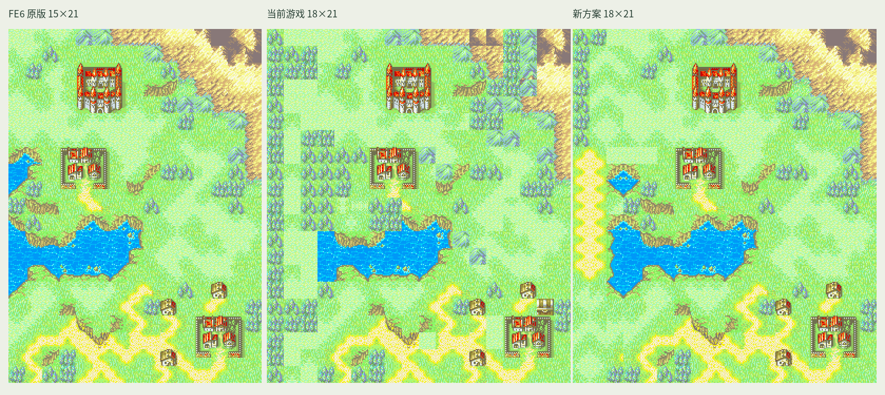

# 第一章：原版道路优先方案（待评审）

[查看新方案大图](ch1-map-refined-v3.png) · [地块表](ch1-map-refined-v3.csv)

## 改动思路

- **以原版为底图**：从 `abab2af` 中提取原始 15×21 地图，整体向右平移 3 格。由现有 `MapAsset01` 渲染得到的原版图与 `MapTsa_Ch1.png` 逐像素相同。
- **尽量保留原版道路和细节**：原版 315 格保留 310 格，其余 5 格在湖西边界附近用于补岸。原版城堡、两村、房屋、东侧山脊及南部原有黄路的相邻地块均完整保留，不再大面积替换为单调草地。原版黄色路面多数的地形语义是 `PLAINS`，不是 `ROAD`。
- **西侧新区域**：新增三列，以原版风格的草地与林缘填充，并在湖西侧增加一段黄色道路。道路位于新图 x=0..1、y=7..14；北端和南端渐变回草地，因此目前是**林间侧道**，不是与城堡和南村原黄路无缝接通的完整路网。保留这一点是为了避免在没有视觉确认的情况下强行修改原版道路接缝。
- **湖岸**：不再把原版地图左边界截断的水面原封不动放到地图内部。上方小水湾和下方较大水面分别补西岸，沿用原版右侧和南侧岸线。下方两处原版内部水色边缘仍有启发式警告，见下。
- **宝箱**：方案不含宝箱，`(16,16)` 是原版草地；当前游戏的地图及 `EvtListChest` 还未改，定稿后需同时移除宝箱地块与事件。

## 已检查

- CSV 尺寸为 18×21，地块都在现有 tileset 内；城堡、两村 3×3 组件和三个房屋维持现行事件坐标。
- 新增黄路主体内部及两端上下连接处的 16 像素边缘，逐像素完全一致；**仅限路体内部**，不代表路与周边草地或岸线的美术接缝已验收。
- 依实际 `TsaConf` 地形 LUT 和各职业移动消耗，静态检查五名角色均可到两村与城门；未考虑战斗、占格和事件，不能当作实战结论。
- 湖岸水色掩码检查还在原版保留区域提示两条接边：`(3,12)→(4,12)`、`(4,13)→(4,14)`。这是粗略颜色启发式，不能区分原图纹理与真实断面；未凭算法强改原版，需要人工看图。
- 现有 T5 两名敌人的载入点 `(6,8)`、`(7,8)` 仍位于不可通行村庄组件；后续实现时需调整并测试事件。

## 限制与下一步

本图是地块拼接预览，并非游戏内截图。当前环境无法直接目视图片，**不能保证路的起止形态、湖岸和草地过渡自然**。请先审阅尤其是湖西黄色侧道：如果希望它与原版南部主路连续相接，需要进一步重绘接入处并同步测试对应地形。当前没有修改 `.c`，没有执行构建或模拟器。

可复现脚本为 `ch1-map-refined.py`；默认拒绝覆盖现有预览和 CSV。
