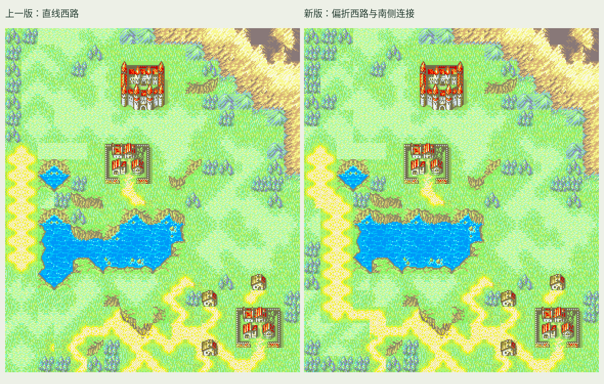

# 第一章：西侧重设计（评审稿）

[查看新版地图大图](ch1-west-v5.png) · [地块表](ch1-west-v5.csv)

## 这次调整

- 西路从北部靠左的位置进入，绕过上方水湾后向东偏移一格，不再从头到尾贴着地图边缘拉直线；南端向东转入原版南部道路。
- 为容纳侧道，湖的西北岸局部向东内缩，重新拼合水边和转角，而不是用一整排树遮住截断面。湖东侧、南侧大部分保留原版轮廓。
- 道路以外的西北和西南区域采用草地和小片林缘，而非铺满同一种草地；并保留原版中部与南部既有黄色道路、建筑和地貌。
- 和 15×21 原版整体右移三格比较，保留 294/315 个原版格。改动集中在湖西/北岸与西路南端接入区；城堡、两座村庄和三个房屋的事件格及大建筑组件保持原位。
- 本方案无宝箱；游戏中的宝箱地块与事件仍未修改，正式实现时需同时移除。

## 静态检查

1. 渲染的原版底图与仓库原版 PNG 逐像素一致。方案尺寸 18×21；地形 LUT 与原始资源一致。
2. 从西路北段到原版南部 `(5,18)` 道路，对黄色像素做四邻接搜索，存在一条连续通路；**这不等于每个接缝都美观或道路边缘全都吻合**。特别应目视检查西路向南路转弯、道路与湖岸靠近的地方。
3. 在不考虑战斗、单位占格与事件的情况下，按实际职业移动表检查，Roy、Wolt、Bors、Alen、Marcus 均可从各自实际站位到两个村庄、城门及西路北段。与实际回合流程不同，不视为实机通关验证。
4. 湖岸颜色掩码仍警告 `(10,12)→(10,13)` 和 `(4,13)→(4,14)` 两处；它们是保留自原版的水/岸相邻关系。该粗略检测不能判定是否真正破图，需在图上人工检查。
5. T5 两名增援的现行载入坐标 `(6,8)` 和 `(7,8)` 仍落在不可通行村庄组件；正式实现时须调整并检验过场/跳过。

## 尚未完成

图为实际 metatile 拼接的**静态设计预览**，不是游戏内画面；当前环境不能直接目视，无法承诺道路弯道和岸线视觉自然。没有修改 `.c`、事件或共享 tileset，也未执行构建和模拟器。地块生成与检查脚本是 `ch1-west-v4.py`，输出文件为 v5，默认拒绝覆盖。
