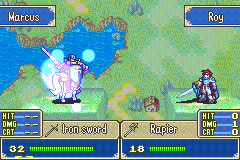

# FE6-rebuild 技能战斗动画移植计划

> 目标：把 `~/fe8u-cskillsys-kernel` 的 C07 / EkrSkill / EfxSkill 链路移植到 FE6-rebuild，
> 让战斗动画（banim）里可以显示技能图标、技能名和技能 BG 动画。
>
> 本文只记录比对结果与实施计划，不代表已经实现。

---

## 0. 结论摘要

1. **只复制 `EkrSkill.c` 不会显示任何动画。**
   `Kernel/Wizardry/Core/SkillSys/EfxSkill/EkrSkill.c` 只有 83 行，它本身不画任何东西：它只是一个调度 proc，
   在 C07 指令处读取本轮技能 ID，然后调用 `NewEfxSkill()` / `NewEfxCombatArt()`，
   并轮询 `EfxSkillExists()`。真正的画面在：
   - `EfxSkill.c`：全屏 BG 帧动画；
   - `EfxSkillBox.c`：技能图标 + 技能名滑入框；
   - `Data/SkillSys/Source/SkillAnimInfo.c`：每个技能对应的 `EfxAnimConf`；
   - `EfxSkill/Utils.c`：按战斗轮次记录 actor / target 技能。

2. **FE6-rebuild 目前只完成了“C07 指令分发”。**
   - `src/Common/banim/source/banim_main.c` 已加入 `BAS_CMD(0x07) -> Banim_C07(anim)`（未提交改动）；
   - `src/Common/banim/C07/c07.c` 是空桩，直接 `return false`；
   - `src/Core/SkillSys/EfxSkkill.c` 只有 `GetActorEfxSkill()` / `GetTargetEfxSkill()` 返回 0；
   - 没有 `NewEfxSkill()`、`EfxSkillExists()`、`NewEfxSkillBox()`、`gpEfxSkillAnims`、技能 BG/图标框资源。

3. **建议按完整链路分阶段移植，而不是只搬 `EkrSkill.c`。**
   最快可见效果的顺序是：
   - Phase 1：C07 handler + EkrSkill proc（先不画东西，保证脚本能正确 block/unblock）；
   - Phase 2：EfxSkill BG 动画（直接复用 FE8 原版 `graphics/efxskill/*.png` 的 16 帧资源）；
   - Phase 3：技能图标 + 技能名框；
   - Phase 4：把 `GetActorEfxSkill()` / `GetTargetEfxSkill()` 接到真实战斗技能；
   - Phase 5：清理、回归、资源整理。

4. **实测确认 C07 路径已经在跑。**
   在第一章 debug 事件触发的剧情战斗里，GDB 断点 `Banim_C07` 命中，
   调用栈为 `BattleAIS_ExecCommands() -> Banim_C07()`。因此 Phase 1 可以直接用现有 `tools/emu/gdb-check.sh` 扩展验证。

---

## 1. 上游代码比对

### 1.1 `fireemblem8u` 与 kernel 的关系

- `fireemblem8u` 里**没有** `EkrSkill.c`。原版 FE8 的技能 BG 实现位于：
  - `src/banim-efxskill.c`：`NewEfxSkillType01BG()`、`EfxSkillType01BGMain()`、`FrameLut_EfxSkill`、`TsaLut_EfxSkill`、`ImgLut_EfxSkill`、`PalLut_EfxSkill`；
  - `data/banim-ekrskill.s`：16 帧 `Img_EfxSkill1..10`、`Pal_EfxSkill1..10`、`Tsa_EfxSkill1..10` 资源。
- kernel 在 `Kernel/Wizardry/Core/SkillSys/EfxSkill/` 下新增：
  - `EkrSkill.c`：本轮技能调度；
  - `EfxSkill.c`：把原版 `EfxSkillType01BG` 重写成通用 `NewEfxSkill()`；
  - `EfxSkillBox.c`：技能图标 + 名字框；
  - `Utils.c`：按轮次记录技能 ID。
- kernel 还把动画冻结/解冻从 `EkrSkill.c` 移到了 `Kernel/Wizardry/Common/BanimHack/Source/C07.c`
  （历史 commit `0d08680b Rewrite banim C07 handler`）。
  **当前 `EkrSkill.c` 只负责“什么时候、给谁、放哪个技能”，不负责冻结动画。**

### 1.2 kernel 与 FE6-rebuild 的文件对照

| 上游（kernel） | FE6-rebuild 对应位置 | 现状 |
| --- | --- | --- |
| `Kernel/Wizardry/Core/SkillSys/EfxSkill/EkrSkill.c` | `src/Common/banim/C07/c07.c`（建议合并） | 空桩 |
| `Kernel/Wizardry/Common/BanimHack/Source/C07.c` | `src/Common/banim/C07/c07.c` | 空桩 |
| `Kernel/Wizardry/Core/SkillSys/EfxSkill/EfxSkill.c` | 无 | 缺 |
| `Kernel/Wizardry/Core/SkillSys/EfxSkill/EfxSkillBox.c` | 无 | 缺 |
| `Kernel/Wizardry/Core/SkillSys/EfxSkill/Utils.c` | `src/Core/SkillSys/EfxSkkill.c` | 只有两个返回 0 的桩 |
| `Data/SkillSys/Source/SkillAnimInfo.c` | 无 | 缺 |
| `Data/SkillSys/EfxSkill/EfxSkillBoxfx.s` | 无 | 缺 |
| `Data/SkillSys/EfxSkill/EfxSkillBoxBG.png` | 无 | 缺 |
| `Contents/EfxAnim/Source/EfxSkillVanilla/*.png` | 无 | 缺（可用 FE8 原版 `graphics/efxskill/*.png` 替代） |
| `include/kernel/efx-skill.h` | 无 | 缺 |
| `include/kernel/efx-anim.h` | 无 | 缺 |
| `src/Core/SkillSys/SkillMapAnim.c` | `src/Core/SkillSys/SkillMapAnim.c` | 已有，但 `MapAnimRoundAnim_DisplaySkillIcon` 尚未 hook |
| `src/Common/banim/source/banim_main.c` C07 分发 | 同文件 | 已加（未提交） |
| `data/banim-ekrskill.s`（FE8） | 无 | 缺，可移植 FE8 资源 |

### 1.3 `EkrSkill.c` 逐项对照与 FE6 适配

| kernel 代码 | 作用 | FE6-rebuild 适配 |
| --- | --- | --- |
| `struct ProcEkrSkill { PROC_HEADER; struct Anim *anim; u8 cid; u16 sid_atk, sid_def; }` | proc 数据 | 去掉 `cid`（FE6 暂无 combat art），保留 `anim/sid_atk/sid_def` |
| `PROC_NAME("EkrSkill")` | 调试名 | 可用 `PROC_NAME_DEBUG("EkrSkill")` |
| `proc = Proc_Start(ProcScr_EkrSkill, PROC_TREE_3)` | 启动 proc | `SpawnProc(ProcScr_EkrSkill, PROC_TREE_3)` |
| `proc->cid = GetEfxCombatArt(round)` | combat art | FE6 无 combat art，先固定 0；后续可加 |
| `proc->sid_atk = GetActorEfxSkill(round)` | 本轮攻击方技能 | 先用 `EfxSkkill.c` 桩；debug 模式下硬编码 |
| `proc->sid_def = GetTargetEfxSkill(round)` | 本轮防守方技能 | 同上 |
| `NewEfxCombatArt(proc->anim, proc->cid)` | 播放 combat art | 删除该分支 |
| `NewEfxSkill(proc->anim, proc->sid_atk)` | 播放攻击方技能 | 需要新增 `NewEfxSkill()` |
| `NewEfxSkill(GetAnimAnotherSide(proc->anim), proc->sid_def)` | 播放防守方技能 | FE6 有 `GetAnimAnotherSide()`；`FARFAR` 跳过逻辑保留 |
| `PROC_WHILE(EfxSkillExists)` | 等技能动画结束 | 新增 `EfxSkillExists()` |
| `EkrSkillExists()` | 给 C07 handler 轮询 | `return Proc_Exists(ProcScr_EkrSkill);` |
| `COMMON_SKILL_VALID(sid)` | 技能 ID 有效性 | `SKILL_IS_VALID(sid)`（`include/hacks/skill-sys.h`） |
| `LTRACEF(...)` | 调试日志 | 删除，或换成 FE6 的 `Printf`/`DebugPrintf`（如有） |
| `#if defined(CONFIG_USE_DEBUG) && defined(CONFIG_DEBUG_EFXSKILL)` | debug 固定技能 | 新增 `CONFIG_DEBUG_EFXSKILL`，固定 `sid_atk = SID_BlowDarting` 便于验证 |

### 1.4 C07 handler 逐项对照

kernel 的 `Kernel/Wizardry/Common/BanimHack/Source/C07.c`：

| kernel | FE6-rebuild 适配 |
| --- | --- |
| `anim->state3` | `anim->flags3` |
| `anim->state` | `anim->flags` |
| `ANIM_BIT_FROZEN` | `BAS_BIT_FROZEN` |
| `anim->pScrCurrent` | `anim->scrCur` |
| `GetAISLayerId(anim)` | `GetAnimLayer(anim)` |
| `Proc_Start(ProcScr_BanimC07Handler, PROC_TREE_3)` | `SpawnProc(ProcScr_BanimC07Handler, PROC_TREE_3)` |
| `anim1 = gAnims[GetAnimPosition(anim) * 2]` | 同 |
| `anim2 = gAnims[GetAnimPosition(anim) * 2 + 1]` | 同 |
| `PROC_WHILE(EkrSkillExists)` | 同 |
| `BanimC07_UpdateHpCost()` / `EfxHpCostExists()` | FE6 暂无 HP cost 系统，Phase 1 先删除该段 |

C07 handler 的核心逻辑：

```c
void Banim_C07(struct Anim *anim)
{
    struct ProcC07Handler *proc;

    /* BasRunScript 已经先 scrCur++；这里减回去，让 C07 每帧重新执行，形成 block */
    anim->scrCur--;

    if (!(anim->flags3 & ANIM_BIT3_BLOCKING)) {
        anim->flags3 |= ANIM_BIT3_BLOCKING;

        if (GetAnimLayer(anim) == 0) {
            proc = SpawnProc(ProcScr_BanimC07Handler, PROC_TREE_3);
            proc->anim = anim;
        }
    }

    if (anim->flags3 & ANIM_BIT3_BLOCKING) {
        if (anim->flags3 & ANIM_BIT3_BLOCKEND) {
            anim->flags3 &= ~ANIM_BIT3_BLOCKING;
            anim->flags3 &= ~ANIM_BIT3_BLOCKEND;
            anim->scrCur++;
        }
    }
}
```

要点：
- FE6 的 `BasRunScript()` 在分派前已经 `scrCur++`，所以 C07 必须自己 `scrCur--`；
- C07 不在 `BasRunScript()` 的 "wait 指令" 列表里（`BAS_CMD_WAIT_01..05/13/18/39`），
  不能依赖引擎自动回退；
- 只有 `GetAnimLayer(anim) == 0` 时启动 handler proc，避免前后层各起一份；
- handler proc 负责三只 anim（当前、同侧 front、同侧 back）的 `BLOCKING` + `BAS_BIT_FROZEN`；
- proc 结束时设置 `BLOCKEND` 并清 `BAS_BIT_FROZEN`，C07 看到 `BLOCKEND` 后 `scrCur++` 放行。

### 1.5 `EfxSkill.c` / `EfxSkillBox.c` 的依赖

`EfxSkill.c` 需要：

| 依赖 | FE6-rebuild 状态 |
| --- | --- |
| `EfxAdvanceFrameLut()` | 已有：`src/Common/banim/source/banim_ekrutils.c` |
| `SpellFx_WriteBgMap()` | 已有 |
| `SpellFx_RegisterBgGfx()` | 已有 |
| `SpellFx_RegisterBgPal()` | 已有 |
| `SpellFx_SetSomeColorEffect()` | 已有 |
| `SpellFx_ClearBG1()` | 已有 |
| `SpellFx_ClearColorEffects()` | 已有（等价于 kernel 的 `SetDefaultColorEffects_()`） |
| `PlaySFX()` | 已有：`include/banim.h` |
| `SetBgOffset()` | 已有：`include/hardware.h`（kernel 用 `BG_SetPosition`） |
| `gBg1Tm` | 已有；kernel 用 `gBG1TilemapBuffer`，FE6 是 32 宽 |
| `gEkrDistanceType` / `EKR_DISTANCE_*` | 已有 |
| `GetAnimPosition()` / `GetAnimAnotherSide()` | 已有 |
| `gpEfxSkillAnims` / `EfxAnimConf` | **缺** |
| `IS_ROM_DATA()` | **缺**（FE6 无此宏，改用空指针/表范围判断） |

`EfxSkillBox.c` 需要：

| 依赖 | FE6-rebuild 状态 |
| --- | --- |
| `ApplyPalette()` | 已有；但 OBJ 调色板要用 `ApplyObPalette()` |
| `InitSpriteTextFont()` / `InitSpriteText()` / `Text_InsertDrawString()` | 已有：`vanilla/text.c` |
| `GetStringTextCenteredPos()` | 已有 |
| `SetTextFontGlyphs(TEXT_GLYPHS_SYSTEM)` | 已有 |
| `SpriteText_Clear()` | **缺**；用 `ClearTextPart(&text, 0, 6)` 或 `CpuFastFill16` |
| `GetSkillNameStr()` | 已有：`src/Core/SkillSys/SkillInfo.c` |
| `GetStringFromIndex()` / `GetCombatArtName()` | combat art 部分删除 |
| `GetIconGfx()` | 已有但是 `static`（`src/Common/icon/icon.c`）；需要导出或改用 `PutIconObjImg()` |
| `Copy2dChr()` | 已有：`include/util.h` |
| `AnimCreate()` | FE6 用 `BasCreate(script, displayPriority)` |
| `anim->oam2Base` | FE6 是 `anim->oam2` |
| `gpAnimScr_EfxSkillBox*` | **缺**，需要移植 `.s` |
| `gpImg_EfxSkillBoxBG` | **缺**，需要移植 48x16 PNG |
| `gGenericBuffer` | FE6 无；用 `gBuf`（0x2000）或 `gBuf_Banim` |
| `gBG1TilemapBuffer` | FE6 用 `gBg1Tm` |

---

## 2. FE6 侧关键差异与风险

### 2.1 字段/API 命名

FE6-rebuild 的 banim 结构体叫 `struct BaSprite`，`#define Anim BaSprite`。
主要字段映射：

```
FE8 kernel                     FE6-rebuild
struct Anim                    struct BaSprite
anim->state                    anim->flags
anim->state3                   anim->flags3
anim->pScrCurrent              anim->scrCur
anim->oam2Base                 anim->oam2
GetAISLayerId(anim)            GetAnimLayer(anim)
EKR_POS_L                      POS_L
AnimCreate(scr, prio)          BasCreate(scr, prio)
Proc_Start(scr, tree)          SpawnProc(scr, tree)
```

### 2.2 C07 指令语义与阻塞

- FE6 原版 122 个 vanilla banim 脚本中，有 81 个含 `ANIMSCR_CMD 0x07`（`gamedata/banim-data/vanilla_scripts/*.scr.S`）。
  物理、魔法、杖等攻击脚本都有，覆盖足够。
- `BasRunScript()` 先把 `scrCur++` 再分派，所以“wait 类”指令会自己 `scrCur--`。
  C07 不在这个名单里，必须由 `Banim_C07()` 自己回退。
- `BattleAIS_ExecCommands()` 每帧处理 command queue，处理完 `cqSize--`。
  C07 的持续阻塞依赖 `BasRunScript()` 每帧重新压入 C07（由 `scrCur--` 保证）。
- 结束时必须 `scrCur++`，否则会死循环；proc 侧必须设置 `BLOCKEND`，否则永远不结束。

### 2.3 BG tilemap 差异

- FE8 kernel：`gBG1TilemapBuffer` 是 64 宽（0x20 步长），写入 30x20 TSA 后清右侧两列。
- FE6：`gBg1Tm` 是 32x32（`extern u16 gBg1Tm[0x400]`），`SpellFx_WriteBgMap()` 用
  `EfxTmCpyBG(..., 30, 20, ...)`，从 `gBg1Tm[0]` 开始写，右侧第 30/31 列不会自动清。
  移植时保留 kernel 的清理循环，但建议填 0（而不是 `gBg1Tm[0]`）：

```c
for (i = 0; i < 0x14; i++) {
    gBg1Tm[0x20 * i + 0x1E] = 0;
    gBg1Tm[0x20 * i + 0x1F] = 0;
}
EnableBgSync(BG1_SYNC_BIT);
```

### 2.4 VRAM 差异

kernel 的 `EfxSkillBox` 使用：

```
ICON_OBJ_CHR      = 0x40
TEXT_OBJ_CHR      = 0x42   /* 与 icon 的 0x42/0x43 有重叠 */
TEXT_BG_OBJ_CHR   = 0x00
ICON_OBJ_PAL      = 0x2
TEXT_OBJ_PAL      = 0xF
```

FE6 banim 的 OBJ VRAM 大致占用：

```
0x0000 - 0x07FF   可能空闲（C07 期间）
0x0800 - 0x17FF   VRAMOFF_BANIM_SPELL_OBJ（C05 法术对象）
0x1C00 - 0x1FFF   EKR gauge 数字/图标/箭头
0x2000 - 0x3FFF   左侧 main anim（VRAMOFF_OBJ_4000）
0x4000 - 0x5FFF   右侧 main anim（VRAMOFF_OBJ_6000）
0x6000 - 0x7FFF   其他
```

C07 发生在 C05 之前，`0x0800` 区在 C07 时是空闲的。建议不要照抄 kernel 的 0x40/0x42 重叠布局，
改用不重叠的分配，例如：

```
ICON_OBJ_CHR      = 0x40   /* 0x800 - 0x87F, 4 tiles */
TEXT_OBJ_CHR      = 0x44   /* 0x880 - 0x9FF, 12 tiles */
TEXT_BG_OBJ_CHR   = 0x50   /* 0xA00 - 0xB7F, 12 tiles */
ICON_OBJ_PAL      = 0x2
TEXT_OBJ_PAL      = 0xF
```

调色板：
- 图标：`ApplyIconPalette(0, 0x10 + ICON_OBJ_PAL)`；
- 文字：`ApplyObPalette(Pal_Text, TEXT_OBJ_PAL)`（注意不是 `ApplyPalette(..., 0x10 + pal)`，FE6 的 `ApplyPalette` 是 BG 相对偏移）；
- 文字字体：`InitSpriteTextFont(font, OBJ_VRAM0 + TEXT_OBJ_CHR * 0x20, TEXT_OBJ_PAL)`。

### 2.5 `gEfxBgSemaphore` / `SpellFx_Begin/Finish`

FE6 的技能 BG 会走和法术 BG 相同的 BG1 通道。建议仿照 `EfxMagfcast.c` / `EfxMagiDummy.c`：

```c
void NewEfxSkill(struct Anim *anim, int sid)
{
    if (gEfxBgSemaphore != 0)
        return;

    SpellFx_Begin();
    gEfxBgSemaphore++;
    ...
}

static void EfxSkillOnEnd(struct ProcEfxSkill *proc)
{
    SpellFx_ClearBG1();
    SpellFx_ClearColorEffects();
    gEfxBgSemaphore--;
    SpellFx_Finish();
}
```

- `SpellFx_Begin()` 置 `gEfxSpellAnimExists = true`，让 HP bar / death 等效果等待；
- `SpellFx_Finish()` 清回 false；
- `gEfxBgSemaphore` 防止和 `EfxMagfcast` 等其他 BG 特效叠加。
- 建议在 proc 的 `PROC_ONEND` 里做清理，防止 proc 被中途 `Proc_End` 时 semaphore 泄漏。

### 2.6 combat art

FE6-rebuild 没有 combat art 系统：
- `GetCombatArtIcon()` 返回 NULL；
- `COMBART_VALID` / `GetEfxCombatArt` 不存在；
- `SkillInfo` 只有 20 个 SID。

Phase 1–4 先完全删除 `cid` / `NewEfxCombatArt` 分支。等 FE6 将来有 combat art 再补。

### 2.7 真实技能注册缺失

kernel 的 `GetActorEfxSkill()` / `GetTargetEfxSkill()` 依赖 `RegisterActorEfxSkill()` /
`RegisterTargetEfxSkill()` 在战斗计算时把技能 ID 写入 `sEfxSkillRoundData[round]`。
FE6-rebuild 目前：

- `src/Core/SkillSys/EfxSkkill.c` 已实现 `Register*` / `Get*`，但目前没有注册调用者，
  所以 `GetActor/TargetEfxSkill()` 恒为 0；
- `src/SkillEffects/BattleSkills/AttackerSkills.c` / `DefenderSkills.c` 只处理 pre-battle 属性，没有注册 Efx；
- 没有 `GetEfxSkillPriority()`。

Phase 1–3 用 debug 模式固定技能，先验证画面；Phase 4 再补真实注册。

### 2.8 资源格式

FE8 原版技能 BG 资源是 240x160 PNG，经 `scripts/gfxtools/tsa_generator.py`（method 1）生成：

```
*.feimg1.bin   固定 0x2000 字节（0x100 tiles，含 padding）
*.fetsa1.bin   30x20 TSA，1200 字节
*.gbapal       0x20 字节
```

这与 FE6 的 `SpellFx_RegisterBgGfx(..., 0x2000)` / `SpellFx_WriteBgMap(..., 30, 20, ...)` /
`SpellFx_RegisterBgPal(..., 0x20)` **完全匹配**。所以优先移植 FE8 原版 16 帧资源，
而不是用 FE6 的 `EfxMagfcast` 占位。

---

## 3. 目标文件布局

建议：

```
src/Common/banim/C07/
├── README.md              <- 本文
├── c07.c                  <- Banim_C07 + ProcC07Handler + ProcEkrSkill + NewEkrSkill
├── efxskill.c             <- NewEfxSkill + ProcScr_EfxSkill + EfxSkillExists
├── efxskillbox.c          <- NewEfxSkillBox + ProcScr_EfxSkillBox + EfxSkillBoxExists
├── efxskillboxfx.s        <- 图标/名字框的 AnimScr
└── efxskill-data.c        <- EfxAnimConf、FrameLut、Tsa/Img/Pal LUT、gpEfxSkillAnims

src/Core/SkillSys/
└── EfxSkkill.c            <- 轮次数据 + Register/Get + 优先级（可改名为 EfxSkill.c）

include/hacks/
└── skill-sys.h            <- 新增 efx-skill 原型

include/
└── efx-skill.h            <- 新增：NewEkrSkill/EfxSkill*/EfxSkillBox* 原型

contents/skillsys/EfxSkill/
├── efxskill_1.png ... efxskill_16.png
├── efxskill_*.feimg1.bin.lz
├── efxskill_*.fetsa1.bin.lz
└── efxskill_*.gbapal

contents/skillsys/EfxSkillBox/
└── EfxSkillBoxBG.png -> .4bpp.lz
```

也可以按用户建议先把 EkrSkill 部分全部塞进 `c07.c`，等 Phase 2 再拆文件。

---

## 4. 分阶段计划

### Phase 0：基线与保护

- [x] 当前 `make all` 通过（已确认）。
- [x] `./tools/emu/run-tests.sh --quick` 通过（已确认）。
- [x] GDB 确认第一章 debug 战斗命中 `Banim_C07`（已确认）。
- 保留现有未提交改动：
  - `src/Common/banim/source/banim_main.c` 的 C07 分发；
  - `src/Common/banim/C07/` 目录与空桩。
  不要回滚、不要提交（按 AGENTS 约定）。

### Phase 1：C07 handler + EkrSkill proc

目标：C07 能正确阻塞/放行动画脚本，EkrSkill proc 能启动并按轮次等待。
此时还看不到技能 BG，但可以用 GDB 断点和“战斗不卡死”验证。

改动：

1. `src/Common/banim/C07/c07.c`
   - 实现 `ProcScr_BanimC07Handler`；
   - 实现 `LockSetAnimState()` / `UnlockAnimState()`；
   - 实现 `Banim_C07()`（`scrCur--` / `scrCur++`、`flags3`、`BAS_BIT_FROZEN`、`GetAnimLayer`）；
   - 暂时去掉 HP cost 段。
2. 同文件或新文件实现 `ProcEkrSkill`：
   - `NewEkrSkill()`：`round = anim->nextRoundId - 1`，取 sid；
   - `EkrSkillOnInit()` / `EkrSkillOnEnd()` 先留空；
   - `NewEfxSkillForAttacker()` / `NewEfxSkillForDefener()` 先调用 `NewEfxSkill()`（Phase 2 再实现）；
   - `EkrSkillExists()`。
3. `include/hacks/skill-sys.h` 增加原型：
   ```c
   void NewEkrSkill(struct Anim *anim);
   bool EkrSkillExists(void);
   void NewEfxSkill(struct Anim *anim, int sid);
   bool EfxSkillExists(void);
   ```
4. debug 模式：
   ```c
   #if defined(CONFIG_USE_DEBUG) && defined(CONFIG_DEBUG_EFXSKILL)
       proc->sid_atk = SID_BlowDarting;
       proc->sid_def = SID_BlowDeath;
   #endif
   ```
   `CONFIG_DEBUG_EFXSKILL` 加到 `include/configs/`（先不默认开启）。

验收：

- `make all` 通过；
- `./tools/emu/run-tests.sh --quick` 通过；
- `gdb-check.sh` 增加 `break Banim_C07` / `break NewEkrSkill`，两者命中；
- 第一章 debug 战斗能正常结束，不会卡在 C07（用 `--frames` / 自动跑图验证）。

#### Phase 1 实施记录（2026-11-08）

已实现：

- `src/Common/banim/C07/c07.c`
  - `ProcScr_BanimC07Handler` / `LockSetAnimState()` / `UnlockAnimState()`；
  - `Banim_C07()`：`scrCur--`、`BLOCKING`、`BLOCKEND`、`scrCur++`；
  - `ProcScr_EkrSkill` / `NewEkrSkill()` / `EkrSkillExists()`；
  - `NewEfxSkill()` / `EfxSkillExists()` 暂为 Phase 1 占位（不画东西）。
- `include/hacks/skill-sys.h`
  - 引入 `banim_sprite.h`，新增 `NewEkrSkill` / `EkrSkillExists` /
    `NewEfxSkill` / `EfxSkillExists` 原型。
- `include/configs/configs/config-debug.h`
  - 新增 `CONFIG_DEBUG_EFXSKILL 0`（默认关闭）。

验证结果：

- `make all -j8`：通过；
- `./tools/emu/run-tests.sh --quick`：4 项全过；
- `./tools/emu/run-tests.sh`：26 项全过；
- 30,000 帧 debug 战斗长跑：`DONE`，无 `CRASH`；
- GDB 断点（第一章 debug 战斗）：
  - `Banim_C07`、`NewEkrSkill`、`C07Handler_End` 均命中；
  - 第一次 C07 在 `gEkrDebugTimer=41`，放行在 `t=49`，即 block 约 8 帧；
  - 观察到 4 轮 C07 序列（4 次 `NewEkrSkill` + 4 次 `C07Handler_End`），全部正常结束；
  - 放行时 `flags3=0x0064`（`BLOCKING|BLOCKEND|C01_BLOCK_END_PREBATTLE`），符合预期。

未做（留给后续阶段）：

- 实际画面：`NewEfxSkill()` 仍是空实现，`EfxSkillExists()` 恒 `false`；
- HP cost 段：FE6 暂无对应系统，Phase 1 直接略过；
- Phase 2 的 BG 资源、Phase 3 的图标/名字框、Phase 4 的真实技能注册。

### Phase 2：EfxSkill BG 动画（核心可见效果）

目标：C07 处出现 16 帧全屏技能 BG，结束后完全清理。

资源：

1. 从 `~/fireemblem8u/graphics/efxskill/efxskill_1..16.png` 复制 16 张 240x160 PNG 到
   `contents/skillsys/EfxSkill/`。
2. 用 `tools/scripts/gfxtools/tsa_generator.py`（从 FE8 仓库 vendored）生成：
   - `efxskill_N.feimg1.bin`（固定 0x2000 字节）
   - `efxskill_N.fetsa1.bin`（1200 字节）
3. 用 `tools/gbagfx` 压成 `.lz`（参考 FE6 现有 `contents/banims/*.4bpp.lz`）。
4. 用 `tools/gbagfx` 或 `grit` 生成 `efxskill_N.gbapal`（0x20 字节）。
5. 新增 `gamedata/skill-sys/EfxSkill.S`，用 `.incbin` 定义：
   ```asm
   .section .content_data.skillsys
   .global Img_EfxSkill1
   Img_EfxSkill1: .incbin "contents/skillsys/EfxSkill/efxskill_1.feimg1.bin.lz"
   ...
   .global Tsa_EfxSkill1
   Tsa_EfxSkill1: .incbin "contents/skillsys/EfxSkill/efxskill_1.fetsa1.bin.lz"
   ...
   ```
6. `Makefile` 增加 `%.feimg1.bin %.fetsa1.bin &: %.png` 规则（GNU Make 4.3 grouped
   target）和 `gamedata/skill-sys/EfxSkill.o` 对生成文件的依赖；`*.feimg1.bin` /
   `*.fetsa1.bin` 加到 `.gitignore`。

代码：

1. 新增 `struct EfxAnimConf`（FE6 精简版，不需要 kernel 的 `_unused_header[0x150]`）：
   ```c
   struct EfxAnimConf {
       const s16 *frames;
       u16 const *const *tsas;
       u16 const *const *imgs;
       u16 const *const *pals;
       u16 sfx;
   };
   ```
2. 在 `efxskill-data.c` 里定义：
   ```c
   static const s16 EfxSkillFrameLut[] = {
       0, 2, 1, 2, ... 15, 2, -1
   };
   static u16 const *const EfxSkillTsaLut[] = { Tsa_EfxSkill1, ... };
   static u16 const *const EfxSkillImgLut[] = { Img_EfxSkill1, ... };
   static u16 const *const EfxSkillPalLut[] = { Pal_EfxSkill1, ... };

   const struct EfxAnimConf EfxSkillVanilla = {
       EfxSkillFrameLut, EfxSkillTsaLut, EfxSkillImgLut, EfxSkillPalLut, 0
   };

   struct EfxAnimConf const *const gpEfxSkillAnims[MAX_SKILL_NUM + 1] = {
       [0 ... MAX_SKILL_NUM] = &EfxSkillVanilla   /* 先所有技能共用 */
   };
   ```
   （GCC 指定初始化范围；如果编译器不支持，改成显式循环初始化或 `for` 填充。）
3. `efxskill.c`：
   ```c
   struct ProcEfxSkill {
       PROC_HEADER;
       i16 timer, frame;
       u16 sid;
       struct Anim *anim;
       u16 const *const *imgs;
       u16 const *const *pals;
       u16 const *const *tsas;
       const s16 *frames;
   };

   static void EfxSkillMain(struct ProcEfxSkill *proc)
   {
       int ret = EfxAdvanceFrameLut(&proc->timer, &proc->frame, proc->frames);

       if (ret >= 0) {
           int i;

           SpellFx_WriteBgMap(proc->anim, proc->tsas[ret], proc->tsas[ret]);
           SpellFx_RegisterBgGfx(proc->imgs[ret], 0x2000);
           SpellFx_RegisterBgPal(proc->pals[ret], 0x20);

           for (i = 0; i < 0x14; i++) {
               gBg1Tm[0x20 * i + 0x1E] = 0;
               gBg1Tm[0x20 * i + 0x1F] = 0;
           }
           EnableBgSync(BG1_SYNC_BIT);
           SpellFx_SetSomeColorEffect();
       }

       if (ret == -1)
           Proc_Break(proc);
   }
   ```
4. `NewEfxSkill()`：
   - `if (!SKILL_IS_VALID(sid)) return;`
   - `conf = gpEfxSkillAnims[sid]`，空则 `&EfxSkillVanilla`；
   - `if (gEfxBgSemaphore != 0) return;`
   - `SpellFx_Begin(); gEfxBgSemaphore++;`
   - `SpawnProc(ProcScr_EfxSkill, PROC_TREE_3)`；
   - `PlaySFX(conf->sfx, 0x100, anim->xPosition, 1)`；
     **注意**：kernel 用的 `0x3D1` 不在 FE6 的 `include/constants/songs.h` 里，先用 `0`（静音）
     或挑一个 FE6 有效 SE（如 `SONG_3CF`），不要直接照搬 0x3D1；
   - far 距离用 `SetBgOffset(BG_1, 0x18/0xE8, 0)`（FE6 `EfxMagfcast` 的取值，先照抄，后续按实际画面调）。
5. `EfxSkillOnEnd()`：
   - `SpellFx_ClearBG1();`
   - `SpellFx_ClearColorEffects();`
   - `gEfxBgSemaphore--;`
   - `SpellFx_Finish();`
6. `EfxSkillExists()`：`return Proc_Exists(ProcScr_EfxSkill);`

验收：

- 第一章 debug 战斗里能看到 16 帧技能 BG；
- GDB 命中 `NewEfxSkill` / `EfxAdvanceFrameLut`；
- 技能动画结束后，后续攻击帧正常，无残留 BG；
- 截图对比：C07 前 / 中 / 后画面 hash 不同，且中段颜色数明显增加。

#### Phase 2 实施记录（2026-11-08）

已实现：

- 新增资源：
  - `contents/skillsys/EfxSkill/efxskill_1..16.png`（FE8 原版 240x160 技能光效）；
  - `tools/scripts/gfxtools/tsa_generator.py` + `tsa2.py`（从 FE8 仓库 vendored）；
  - `gamedata/skill-sys/EfxSkill.S`（48 个 `.incbin` 符号）。
- `Makefile`：
  - `%.feimg1.bin %.fetsa1.bin &: %.png` grouped target；
  - `gamedata/skill-sys/EfxSkill.o` 依赖 `.feimg1.bin.lz` / `.fetsa1.bin.lz` / `.gbapal`；
  - 生成文件加入 `CLEAN_FILES2`，`.gitignore` 忽略 `.feimg1.bin` / `.fetsa1.bin`。
- 新增 `include/efx-skill.h`：`struct EfxAnimConf`、`gpEfxSkillAnims`、`EfxSkillVanilla`。
- 新增 `src/Common/banim/C07/efxskill-data.c`：16 帧 FrameLut、Tsa/Img/Pal LUT、
  `gpEfxSkillAnims[0 ... MAX_SKILL_NUM] = &EfxSkillVanilla`。
- 新增 `src/Common/banim/C07/efxskill.c`：`NewEfxSkill()` / `ProcScr_EfxSkill` /
  `EfxSkillMain()` / `EfxSkillOnEnd()` / `EfxSkillExists()`；
  - `SpellFx_Begin()` + `gEfxBgSemaphore++`；
  - 每帧 `SpellFx_WriteBgMap` / `RegisterBgGfx` / `RegisterBgPal`；
  - 清理 `gBg1Tm` 右侧两列；
  - 结束时 `SpellFx_ClearBG1` / `ClearBG1Position` / `ClearColorEffects` /
    `gEfxBgSemaphore--` / `SpellFx_Finish`。
- `c07.c` 删除 Phase 1 的 `NewEfxSkill` / `EfxSkillExists` 占位。

验证结果：

- `make all -j8`：通过；
- `./tools/emu/run-tests.sh --quick`：4 项全过；
- `./tools/emu/run-tests.sh`（`CONFIG_DEBUG_EFXSKILL 0`）：26 项全过；
- `CONFIG_DEBUG_EFXSKILL 1` 时：
  - GDB 命中 `NewEfxSkill`（sid=9）、`EfxSkillMain` 33 帧、`EfxSkillOnEnd`；
  - `gEkrDebugTimer` 从 45 到 79，动画约 33 帧；
  - 截图在 8440–8490 看到蓝色/白色光球按帧变化，8490 后消失；
    
  - 状态检查：`gBg1Tm[0]=0x110F`（tile 0x10F + palette 1）、
    `gPal[0x20]=0x5355`、VRAM `0x060021E0` 有图像数据；
  - `gEfxBgSemaphore=1`、`gEfxSpellAnimExists=1` 在动画期间正确置位。

已知限制：

- `CONFIG_DEBUG_EFXSKILL` 默认 0；真实技能注册在 Phase 4，所以在正常流程里
  暂时还不会自动触发（Phase 2 用 debug 模式验证画面）。
- `sfx` 先设为 0；FE6 没有 0x3D1，等选定 SE 后再填。
- 还没有技能图标/名字框（Phase 3）。

### Phase 3：技能图标 + 技能名框

目标：技能 BG 上出现图标和技能名，结束后 sprite 正常消失。

资源：

1. 复制 `Data/SkillSys/EfxSkill/EfxSkillBoxBG.png`（48x16）到
   `contents/skillsys/EfxSkillBox/`，生成 `.4bpp.lz`。
2. 复制 `Data/SkillSys/EfxSkill/EfxSkillBoxfx.s` 到 `src/Common/banim/C07/efxskillboxfx.s`：
   - 把 `.section .rodata` 改为 `.section .content_data`（与 FE6 其他资源一致）；
   - `.include "animscr.inc"` / `.include "gba_sprites.inc"` 已存在；
   - 宏 `ANIM_SPRITE` / `ANIMSCR_FORCE_SPRITE` 与 kernel 兼容，基本可直接用；
   - 把 `sprite_right_*` 之类标签重命名，避免和现有符号冲突。

代码：

1. `NewEfxSkillBox()` 仿 kernel，但：
   - `GetIconGfx()` 是 static：在 `src/Common/icon/icon.c` 增加
     `const u8 *Icon_GetGfx(u32 icon) { return GetIconGfx(icon); }`，
     并在 `include/icon.h` 声明；或者直接改用 `PutIconObjImg(SKILL_ICON(sid), ICON_OBJ_CHR)`。
   - `LoadIconPalette` → `ApplyIconPalette(0, 0x10 + ICON_OBJ_PAL)`；
   - `ApplyPalette(Pal_Text, 0x10 + TEXT_OBJ_PAL)` → `ApplyObPalette(Pal_Text, TEXT_OBJ_PAL)`；
   - `SpriteText_Clear` → `ClearTextPart(&proc->text, 0, 6)`；
   - `AnimCreate(scr, 0x95)` → `BasCreate(scr, 0x95)`；
   - `anim->oam2Base` → `anim->oam2`；
   - `Decompress(gpImg_EfxSkillBoxBG, gGenericBuffer)` → `Decompress(gpImg_EfxSkillBoxBG, gBuf)`；
   - `GetAnimPosition(...) == EKR_POS_L` → `== POS_L`。
2. `EfxSkillBoxIdle()` 里 `anim->state != 0` → `anim->flags != 0`。
3. `EfxSkillOnInit()` 调用 `NewEfxSkillBox(proc->anim, 0, icon, proc->sid, EFX_SKILL_BOX_SKILL)`；
   `NewEfxSkill()` 结束前等待 `EfxSkillBoxExists()`（kernel 的 `PROC_WHILE(EfxSkillBoxExists)`）。
4. 名字文本：FE6 的 `GetSkillNameStr()` 可用，desc 里含 `:`，`GetSkillNameStrFormDesc()` 能截出名字。

验收：

- 图标和名字出现，左右侧位置正确；
- 名字不超框，UTF-8 / narrow font 正常；
- 技能框结束后 sprite 全部消失，无残留 OAM/VRAM 花屏；
- 截图对比左右站位、远/近距离。

### Phase 4：真实技能注册

目标：不再依赖 debug 硬编码，技能动画由实际技能触发。

改动：

1. `src/Core/SkillSys/EfxSkkill.c`：
   - `struct BattleHitExpa { u16 sid_actor, sid_target; };`（定义在 `include/battle.h`）
   - `gBattleHitExpa` 定义在 `src/Core/BattleSys/Source/battle.c`（`battle.h` 里 extern）
   - `RegisterActorEfxSkill(round, sid)` / `RegisterTargetEfxSkill(round, sid)`：
     先比较优先级（`GetEfxSkillPriority(sid_old) > GetEfxSkillPriority(sid)` 则忽略），再写入；
   - `GetActorEfxSkill(round)` / `GetTargetEfxSkill(round)`：`round < 0 || round >= BATTLE_HIT_MAX`
     时返回 0；
   - `GetEfxSkillPriority(sid)`：先返回 0，后续可加 `u8` 表。
2. `src/Core/BattleSys/Source/battle.c` 的 `ClearBattleHits()` 里直接
   `memset(gBattleHitExpa, 0, sizeof(gBattleHitExpa));`，不再有单独的
   `InitEfxSkillRoundData()`。
3. 在技能发动处注册：
   - 现有 FE6 技能多为 pre-battle（Blow 系），可以在 `PreBattleCalc_AttackerSkills()` 里对触发技能
     注册一个“本轮”或“首轮”的 Efx；
   - 更准确的做法是仿 kernel，在 `BattleGenerateHitAttributes()` / 伤害计算里按
     `GetBattleHitRound(gBattleHitIt)` 注册；
   - **当前阶段先不实现 `SetupEfxSkillRoundData()`**，只保留 `Register*` 接口，等注册策略确定。
4. `GetEfxSkillPriority()` 表可仿 kernel 的 `Data/SkillSys/Source/SkillAnimInfo.c`，
   只给少数技能配置 `EFX_PRIORITY_LOW/NORMAL/HIGH`，其余 0。

验收：

- 不打开 `CONFIG_DEBUG_EFXSKILL` 时，技能动画仍能出现；
- 不同技能显示不同图标/名字（如果 `gpEfxSkillAnims` 已按 SID 分配）；
- 多轮战斗（追击、反击）中技能动画按轮次出现；
- 无技能时不播动画，不阻塞。

#### Phase 4 实施记录（2026-11-08）

本轮只保留数据基础设施，**自动注册策略暂不实现**（后续讨论）。

已实现：

- `include/battle.h`
  - 公开 `#define BATTLE_HIT_MAX 20`；
  - 新增 `struct BattleHitExpa { u16 sid_actor, sid_target; };`
  - `extern struct BattleHitExpa gBattleHitExpa[BATTLE_HIT_MAX];`
- `src/Core/BattleSys/Source/battle.c`
  - 在 `gBattleHits` 旁边定义 `gBattleHitExpa`；
  - `ClearBattleHits()` 里 `memset(gBattleHitExpa, 0, sizeof(gBattleHitExpa));`
  - `BattleUnwind()` 只调用 `ClearBattleHits()`；
  - `BeginBattleAnimations()` 不 setup / clear。
- `src/Core/SkillSys/EfxSkkill.c`
  - 不再定义自己的数组，直接使用 `extern gBattleHitExpa`；
  - 只保留 `RegisterActorEfxSkill()` / `RegisterTargetEfxSkill()` /
    `GetActorEfxSkill()` / `GetTargetEfxSkill()`；
  - `GetActorEfxSkill()` / `GetTargetEfxSkill()` 带 `round < 0 || round >= BATTLE_HIT_MAX` 保护；
  - `GetEfxSkillPriority()` 暂返回 0；
  - `InitEfxSkillRoundData()` / `SetupEfxSkillRoundData()` 都已删除。
- `src/Core/SkillSys/SkillList.c`
  - 不再在 `UnitToBattle_SetupSkillList()` 里清 EfxSkill。
- `include/hacks/skill-sys.h`
  - 只保留 `Register*EfxSkill()` / `Get*EfxSkill()` 原型。

当前行为：

- 正常 ROM 不会自动播放技能动画，因为没有任何 `Register*EfxSkill()` 调用，
  `GetActorEfxSkill()` / `GetTargetEfxSkill()` 恒为 0；
- 需要看画面时仍可用 `CONFIG_DEBUG_EFXSKILL 1`（Phase 2 的 debug 路径）；
- 后续确定注册策略后，在战斗 hit 生成/伤害计算里调用 `Register*EfxSkill()` 即可。

验证结果：

- `make all -j8`：通过；
- `./tools/emu/run-tests.sh --quick`：4 / 4 通过；
- `./tools/emu/run-tests.sh`：26 / 26 通过；
- 由于没有注册，正常 ROM 下 GDB 不会命中 `NewEfxSkill`，这是预期行为。

注意：

- `ClearBattleHits()` 现在也会清空 `BattleHitExpa`。`vanilla/event.c` 剧情战斗的第二次
  `ClearBattleHits()` 会清空 per-round 数据；后续讨论注册策略时，需要决定 event 路径是
  在覆盖 hits 前保存/复制，还是在覆盖后重新注册。

### Phase 5：清理与回归

- 删除调试硬编码（保留 `CONFIG_DEBUG_EFXSKILL` 开关）；
- 确认 `EfxSkkill.c` 命名是否改为 `EfxSkill.c`（当前是拼写错误，但改名会影响 include/构建，
  建议单独一次改动）；
- 资源整理：`.lz` / `.bin` 是否提交、生成脚本是否放在 `tools/scripts/`；
- 全量 `./tools/emu/run-tests.sh`；
- 手动/截图检查：普通物理、魔法、远程、MISS、暴击、追击、死亡、FARFAR。

---

## 5. 资源方案比较

### 方案 A（推荐）：移植 FE8 原版 `graphics/efxskill/*.png`

- 16 张 240x160 PNG，`tsa_generator.py` + `gbagfx` 生成 `.feimg1.bin.lz` / `.fetsa1.bin.lz` / `.gbapal`；
- 与 FE6 `SpellFx_*` 的 `0x2000` / 30x20 / `0x20` 参数完全匹配；
- 效果就是 FE8 原版的技能光效，最接近 kernel；
- 工作量：一次性生成 48 个文件 + 一个 `.s` + 一份数据表。

### 方案 B（最快占位）：复用 FE6 `EfxMagfcast` 资源

- 直接用 `Img_EfxMagfcastBG` / `Tsa1..22_EfxMagfcastBG` / `Pal_EfxMagfcastBG`；
- 不需要新资源，Phase 2 可当天出画面；
- 缺点：看起来像贤者魔法，不是技能光效；只适合临时验证链路。

### 方案 C（长期）：FE6 专用技能 BG

- 按技能设计多套 `EfxAnimConf`；
- 需要美术资源，放在最后。

建议：**Phase 2 用方案 A**；如果时间紧，可以先用方案 B 打通链路，再替换成 A。

---

## 6. 验证计划

### 6.1 构建

```bash
export DEVKITPRO=$HOME/devkitpro
export DEVKITARM=$HOME/devkitpro/devkitARM
make all -j8
```

### 6.2 冒烟 / 全量

```bash
./tools/emu/run-tests.sh --quick
./tools/emu/run-tests.sh
```

### 6.3 GDB 断点

在 `tools/emu/gdb-check.sh` 里增加：

```gdb
break Banim_C07
break NewEkrSkill
break NewEfxSkill
break NewEfxSkillBox
```

第一章 debug 事件会触发剧情战斗，足以覆盖 C07 路径。

### 6.4 截图

- 用 `gbarun --shot <frame>` 抓 C07 前 / 中 / 后帧；
- 对比 `STATS colors` 和 `HASH`；
- 检查左右站位（POS_L/POS_R）、近距离/远距离。

### 6.5 回归重点

- 没有 C07 的 41 个脚本不应对应技能；
- 有 C07 的 81 个脚本不应卡死；
- MISS / 暴击 / 追击 / 死亡；
- 魔法 C05 法术动画与 EfxSkill 的 BG1 不冲突；
- `gEfxBgSemaphore` / `gEfxSpellAnimExists` 在技能结束后归零；
- 中断（战斗提前结束）时 proc 清理不泄漏。

---

## 7. 待确认事项

1. **是否现在就开始 Phase 1 实现？** 还是先只保留本计划文档。
2. **资源选择**：Phase 2 直接用 FE8 原版 `graphics/efxskill/*.png`（方案 A），
   还是先用 `EfxMagfcast` 占位（方案 B）？
3. **`c07.c` 的组织方式**：EkrSkill + C07 handler 都放 `c07.c`，
   还是 Phase 2 起拆成 `efxskill.c` / `efxskillbox.c`？
4. **`EfxSkkill.c` 是否改名**为 `EfxSkill.c`（修正拼写）？改名会影响构建和 include，建议单独确认。
5. **技能动画触发范围**：是所有有效技能都播，还是只给配置了 `gpEfxSkillAnims` 的技能播？
6. **combat art**：FE6 暂无计划，是否先在数据结构里留空，等以后再加？

---

## 8. 参考

- kernel 上游：
  - `Kernel/Wizardry/Core/SkillSys/EfxSkill/EkrSkill.c`
  - `Kernel/Wizardry/Core/SkillSys/EfxSkill/EfxSkill.c`
  - `Kernel/Wizardry/Core/SkillSys/EfxSkill/EfxSkillBox.c`
  - `Kernel/Wizardry/Core/SkillSys/EfxSkill/Utils.c`
  - `Kernel/Wizardry/Common/BanimHack/Source/C07.c`
- FE8 原版：
  - `src/banim-efxskill.c`
  - `data/banim-ekrskill.s`
  - `graphics/efxskill/*.png`
- FE6-rebuild 现有：
  - `src/Common/banim/source/banim_main.c`
  - `src/Common/banim/source/banim_ekrutils.c`
  - `src/Common/banim/hacks/EfxMagfcast.c`
  - `src/Common/banim/hacks/EfxMagiDummy.c`
  - `src/Core/SkillSys/EfxSkkill.c`
  - `include/hacks/skill-sys.h`
  - `docs/banim-commands.md`
